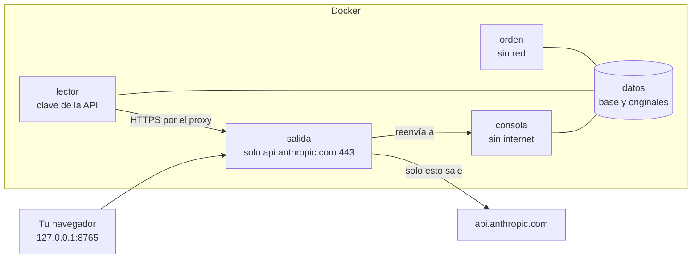

# El entorno local con Docker, paso a paso

Guía para tener bms-agent funcionando en tu propio ordenador con Windows, aislado
del resto del ordenador y de internet, sin instalar Python ni nada más que Docker
Desktop. No hace falta saber programar: todo se hace con dobles clics en unos
ficheros `.bat` y, como mucho, escribiendo una línea.

Si buscas el día a día de la consola (prioridades, corregir un dato, verificar un
IBAN), está en [uso-v1.md](uso-v1.md). Esta guía es sobre dónde y cómo corre.

> **¿Sin Docker?** La instalación nativa de Windows hace lo mismo con el cortafuegos de
> Windows, sin instalar Docker Desktop: [instalacion-nativa.md](instalacion-nativa.md).
> Allí está también qué aísla cada variante (apartado 11).

---

## 1. Qué es, en dos minutos

Docker es un programa que ejecuta otros programas dentro de **contenedores**: cajas
cerradas que solo ven lo que se les deja ver. bms-agent corre en cuatro cajas:

| Caja | Qué hace | Qué puede ver |
| --- | --- | --- |
| **consola** | La consola que abres en el navegador. | Tus datos. **Ninguna salida a internet.** |
| **lector** | Lee los PDF de facturas con la API de Anthropic. Solo arranca cuando tú lo pides. | Tus datos, el buzón y la clave de la API. Solo puede hablar con la caja **salida**. |
| **salida** | La única puerta a internet. Deja pasar al lector hacia `api.anthropic.com` y a nada más, y apunta cada intento en su propio registro, que no se borra al parar. | Internet, pero solo para el lector y solo hacia la API. No ve tus datos. |
| **orden** | Las órdenes sueltas: importar, crear los datos de prueba, hacer copias, ver lo que ha salido. | Tus datos, el buzón y el registro de la salida. **Sin red de ningún tipo.** |



Lo que esto te garantiza:

- **La consola solo se abre desde tu ordenador.** La dirección es
  `http://127.0.0.1:8765/app` (la app, que `iniciar.bat` abre en su propia ventana de
  Edge; la consola de antes sigue en `http://127.0.0.1:8765/consola`, de reserva, ver
  [app-local.md](app-local.md)); desde otro ordenador de la oficina o de casa no
  se llega, aunque esté en la misma red.
- **La consola y los datos no tienen internet.** Aunque alguien colara algo raro en
  una factura, la caja que tiene tus datos no puede mandarlos a ninguna parte.
- **Solo el lector sale, y solo a la API de Anthropic.** Cualquier otro destino lo
  rechaza la caja salida, y queda apuntado.
- **La clave de la API no está en ningún sitio más que en un fichero tuyo**, que
  solo ve el lector.
- Siguen valiendo las reglas de siempre: nada paga solo, nada presenta el BTW solo,
  el IBAN de pago nunca sale de una factura y cada cambio lo firma una persona
  ([arquitectura.md](arquitectura.md)).

---

## 2. Lo que necesitas

| | |
| --- | --- |
| **Ordenador** | Windows 10 o 11 con WSL2 (Docker Desktop lo instala si falta). |
| **Memoria** | 8 GB como mínimo; **16 GB recomendado** si usas el ordenador para otras cosas a la vez. |
| **Disco** | Unos 2 GB libres para Docker y la imagen, más lo que ocupen tus facturas. |
| **Copias** | Un disco SSD externo, cifrado (apartado 9). |
| **Clave de la API** | La de Anthropic, con crédito prepagado (apartado 4). |

---

## 3. Instalar Docker Desktop (una sola vez)

1. Entra en **docker.com/products/docker-desktop**, descarga **Docker Desktop para
   Windows** e instálalo con las opciones que vienen marcadas. Si pregunta por
   **WSL 2**, déjalo marcado.
2. Reinicia el ordenador si te lo pide.
3. Abre **Docker Desktop** desde el menú Inicio. La primera vez te pide aceptar las
   condiciones: con menos de 250 empleados **y** menos de 10 millones de dólares de
   facturación es gratis (apartado 11). No hace falta crear una cuenta para usarlo.
4. Espera a que abajo a la izquierda ponga que el motor está en marcha
   (**Engine running**). A partir de aquí, Docker Desktop tiene que estar abierto
   cuando uses bms-agent.

Para que arranque solo al encender el ordenador: en Docker Desktop, **Settings →
General → Start Docker Desktop when you sign in**.

---

## 4. La clave de la API

1. Saca la clave como dice [instalacion-windows.md](instalacion-windows.md), parte 1
   (console.anthropic.com → API keys → Create Key). Empieza por `sk-ant-`.
2. En **Billing**, compra crédito prepagado y **deja apagada la recarga automática**
   (*auto-reload* o *auto-recharge*): así el gasto nunca pasa del crédito que hayas
   puesto. Es el techo duro (apartado 11).
3. Abre la carpeta del proyecto, entra en `docker\secretos` y crea con el Bloc de
   notas un fichero llamado **`anthropic_api_key.txt`** con la clave en una sola
   línea, sin nada más. Cuidado: el Bloc de notas a veces añade `.txt` otra vez; el
   nombre tiene que quedar exactamente `anthropic_api_key.txt`. Da igual la
   codificación con la que lo guarde (UTF-8, con o sin BOM, o «Unicode»).

Esa carpeta no se sube nunca a git ni entra en la imagen de Docker. Si la clave se
filtra, bórrala en console.anthropic.com, crea otra y cambia el fichero.

---

## 5. La primera vez

En la carpeta `docker` del proyecto:

1. Doble clic en **`iniciar.bat`**. La primera vez tarda unos minutos: está
   preparando el programa. Las siguientes, unos segundos. Al final se abre el
   navegador en la consola.
2. Para entrar en la consola hace falta un **token personal**. Abre una ventana de
   PowerShell en la carpeta `docker` (en el Explorador: clic derecho sobre un hueco
   de la carpeta → **Abrir en Terminal**) y escribe:

   ```powershell
   .\persona.bat -Nombre "Tu nombre" -Rol administrador
   ```

   Sale un token que empieza por `bms_`. **Guárdalo en tu gestor de claves**: se ve
   una sola vez. Es lo que escribes al entrar en la consola y lo que te piden los
   scripts que cambian algo. Para otra persona, lo mismo con su nombre y su rol:
   `-Rol administracion` (el trabajo de cada día) o `-Rol consulta` (solo mirar). El
   rol se dice siempre, para no dar sin querer más de lo pensado. Si la persona ya
   existe con otro rol, el script no le cambia nada ni le da token: lo dice y para.
3. **La empresa.** Sin las cuentas propias de BM Support BV no entra ningún
   extracto del banco (el agente no puede saber si el extracto es de la empresa).
   En la misma ventana, con tu token de administrador:

   ```powershell
   .\empresa.bat -Cuentas "NL02ABNA0123456789,NL44RABO0123456789" -BtwId "NL001122334B01" -Kvk "12345678"
   ```

   con las cuentas de verdad, todas separadas por comas (las que des sustituyen a
   las de antes). `.\empresa.bat -Ver` enseña lo que hay y lo que falta. Queda en
   la base, firmado por ti: no hay que tocar ningún fichero de `config`.
4. **El primer maestro y los trimestres de antes.** Importa los acreedores de
   Exact (apartado 7) y haz lo que dice [uso-v1.md](uso-v1.md), «El primer día»:
   atestar las cuentas heredadas (F0) y anotar los trimestres del BTW que ya se
   presentaron antes de empezar.

---

## 6. Arrancar y parar

| Para | Haz |
| --- | --- |
| Abrir la consola con tus datos | Doble clic en **`iniciar.bat`** |
| Abrir la consola con DATOS DE PRUEBA | `.\iniciar.bat -Demo` (apartado 8) |
| Cerrarla | Doble clic en **`parar.bat`** |

Parar no borra nada: los datos se quedan guardados en Docker y la próxima vez están
igual. Si apagas el ordenador sin parar, tampoco pasa nada.

Al arrancar, `iniciar.bat` hace también **la pasada del día** (`recalcular
--diaria`): lo que depende de la fecha (facturas que vencen, plazos, órdenes de
compra que caducan) se pone al día aunque ese día no importes nada. `importar.bat`
la hace también al acabar. Si dejas la consola abierta varios días seguidos sin
importar, vuelve a abrir `iniciar.bat` cada mañana; si la consola avisa de que
«falta la pasada de hoy», es eso.

---

## 7. Dónde dejar los ficheros

Junto a la carpeta `docker` hay una carpeta **`buzon`** (se crea sola la primera vez
que importas). Cada tipo de fichero va en su sitio:

| Carpeta | Qué va dentro | De dónde sale |
| --- | --- | --- |
| `buzon\facturas` | Los PDF de facturas de proveedores | El correo de administración |
| `buzon\exact\proveedores` | El listado de crediteuren (CSV) | Exact |
| `buzon\exact\clientes` | El listado de debiteuren (CSV) | Exact |
| `buzon\maestro\objetos` | Los Objetos (CSV) | Hecho a mano |
| `buzon\maestro\recursos` | Las personas del planning (CSV) | Hecho a mano |
| `buzon\maestro\contactos` | Los contactos de proveedores y clientes (CSV) | Hecho a mano |
| `buzon\maestro\alias` | Los otros nombres de un proveedor, un cliente o un Objeto (CSV) | Hecho a mano |
| `buzon\maestro\tarifas` | Las tarifas pactadas, de compra y de venta (CSV) | Hecho a mano |
| `buzon\maestro\ciclos` | Los ciclos de facturación (CSV) | Hecho a mano |
| `buzon\trnsprnt` | El planning (CSV) | TRNSPRNT |
| `buzon\po` | La hoja de órdenes de compra (CSV o YAML) | Hecha a mano |
| `buzon\po\modificaciones` | Los cambios de una orden de compra (CSV) | Hecho a mano |
| `buzon\exact\ventas` | Las facturas de venta, con sus líneas (CSV) | Exact |
| `buzon\exact\pagos` | Openstaande posten / betalingen (CSV) | Exact |
| `buzon\banco` | Los extractos (CAMT.053 `.xml`, MT940 o CSV) | La banca por internet |

Se importan en el orden de la tabla, porque unos usan lo que traen otros: las
tarifas y los ciclos, los Objetos y las personas; las ventas, los clientes y las
órdenes de compra; los pagos, las facturas. Sin las carpetas del maestro, la consola
no puede comparar las horas del planning, las tarifas pactadas ni las órdenes de
compra (los datos de prueba sí las traen). Las columnas de cada CSV están en
`config/importacion/` (un fichero por tipo).

Después:

- **Doble clic en `importar.bat`** para todo lo que no son PDF. No cuesta nada:
  no llama a ninguna API y la caja que importa no tiene red. Te pide tu token. Lo
  que entra entero se mueve a `buzon\hecho\<fecha>\`. Lo que entra con alguna fila
  rechazada también se mueve, y el script lo dice en amarillo con cada fila y su
  motivo: corrígelo en el sistema de origen y vuelve a exportarlo. Lo que no entra
  se queda donde estaba y el script dice por qué; el mismo fichero no entrará nunca
  (se reconoce por su contenido): hay que sacar uno nuevo.
- **Doble clic en `leer-facturas.bat`** para los PDF. **Esto sí cuesta dinero**
  (unos céntimos por factura), así que primero cuenta, gratis, lo que va a mandar,
  te enseña el coste y solo sigue si escribes `si`. Un PDF que ya se leyó no se
  vuelve a pagar.

El buzón solo lo leen las cajas: nada de dentro de Docker puede escribir ni borrar en
él. Lo mueve el script, en tu Windows.

### Las órdenes sueltas (`orden.bat`)

Casi todo el trabajo de cada día se hace en la consola. Lo que [uso-v1.md](uso-v1.md)
escribe como `bms-agent ...` es la orden de la instalación de quien mantiene el
programa; aquí la misma orden se escribe con **`orden.bat`** delante, en una ventana
de PowerShell en la carpeta `docker`:

```powershell
.\orden.bat iban listar
.\orden.bat iban verificar --proveedor-id 3 --iban NL91ABNA0417164300 --telefono "010-1234567" --persona-contactada "Jan de Vries" --motivo "Llamada al número del maestro"
.\orden.bat btw ver 2026-T3
.\orden.bat historial 12
.\orden.bat resumen
```

Te pide tu token (no se ve al escribirlo) y lo pasa por dentro, nunca en la línea de
la orden, y lo olvida al acabar. La orden corre en la caja **orden**, sin red, y
siempre sobre tus datos de verdad (la prueba se mira en la consola de `-Demo`). Sale
con el código de la orden: distinto de 0 si no se hizo, o si se apuntó sin el efecto
pedido (una verificación de IBAN que no vale sale con 5).

Lo que tiene su propio script no va por `orden.bat`: `iniciar.bat` (no `serve`),
`importar.bat` y `leer-facturas.bat` (no `importar` ni `extract`), `persona.bat` (no
`usuario crear` ni `usuario token`), `empresa.bat` (no `empresa fijar`), `copia.bat`
y `restaurar.bat`. Dentro de Docker no se escribe ningún fichero fuera de sus
volúmenes, así que `--salida` no sirve: la hoja del BTW y el PDF original de una
factura se descargan desde la consola.

Si prefieres escribirlo a mano, es lo mismo que hace el script:

```powershell
$env:BMS_TOKEN = Read-Host "Tu token"
docker compose run --rm -T -e BMS_TOKEN orden iban listar
Remove-Item Env:\BMS_TOKEN
```

---

## 8. Datos de prueba y datos de verdad

Para enseñar la consola, practicar o formar a alguien sin tocar nada real:

```powershell
.\iniciar.bat -Demo
```

Eso crea **otra base**, `demo.sqlite3`, con una empresa de seguridad ficticia:
proveedores y clientes inventados (todos con «Demo», «Voorbeeld», «Proef» o
«Fictief» en el nombre), sus Objetos, tarifas con recargo de noche y de fin de
semana, órdenes de compra, facturas de compra y de venta, el banco, el planning y un
trimestre del BTW. Están a propósito los casos que la consola tiene que saber
enseñar: una factura duplicada, un IBAN cambiado, un abono, una factura en dólares,
un intento de engañar al sistema con texto escondido en una factura, facturas
vencidas, una semana trabajada sin facturar y una orden de compra a punto de
agotarse.

- Cada vez que arrancas con `-Demo` los datos de prueba se crean **de nuevo**, con la
  fecha de hoy, y salen **dos tokens** («Ana Demo» y «Bram Demo») para entrar. Solo
  valen en la base de prueba.
- En cada página de la consola hay una **banda roja fija: DATOS DE PRUEBA**. Si la
  ves, nada de lo que hagas toca tus datos.
- Para volver a tus datos: `parar.bat` y luego `iniciar.bat` (sin `-Demo`). La banda
  desaparece.
- **Lo de la prueba nunca pasa a tus datos de verdad.** Los IBAN de prueba son de un
  banco que no existe («DEMO»), todos los ficheros de prueba llevan una marca, y la
  base de verdad rechaza cualquier cosa que la lleve, venga por donde venga. Y una
  copia de la base de prueba con otro nombre no se abre.
- **Y lo de verdad no se pierde en la prueba.** El buzón es el mismo para las dos
  bases. Por eso la base de prueba rechaza todo lo que no lleve la marca:
  `importar.bat -Demo` con un fichero de verdad lo deja en el buzón, sin tocarlo, y
  `leer-facturas.bat -Demo` no lee nada ni paga nada (los datos de prueba ya traen sus
  facturas leídas). Lo de verdad se importa y se lee sin `-Demo`.

---

## 9. Copias de seguridad

Tus datos (la base, los PDF originales y las anclas de la auditoría) viven dentro de
Docker, en un volumen llamado **datos**. No es una carpeta que veas en el Explorador
a propósito: la base necesita bloqueos que la carpeta compartida de Windows no da
bien, y una base a medio copiar no sirve. Por eso la copia se hace con su script.

**Una vez: cifrar el disco externo.** Conecta el SSD, en el Explorador clic derecho
sobre él → **Activar BitLocker** (Windows 10/11 Pro) → contraseña → guarda la clave
de recuperación en tu gestor de claves, **no** en el mismo disco. Con Windows Home,
VeraCrypt (gratis) hace lo mismo.

**Cada semana (y antes de cualquier cambio grande):**

1. Conecta y desbloquea el disco. Crea en él una carpeta, por ejemplo `BMS-copias`.
2. En PowerShell, en la carpeta `docker`:

   ```powershell
   .\copia.bat -Destino E:\BMS-copias
   ```

   (cambia `E:` por la letra de tu disco). Se puede hacer con la consola abierta:
   la copia comprueba también que su auditoría cuadra, como haría `db verificar`.
3. Sale «Copia hecha y comprobada»: la base copiada se abre y cada fichero tiene el
   hash del manifiesto. Cada copia va en su carpeta con fecha y hora, y nunca pisa
   otra.
4. Expulsa el disco con seguridad y guárdalo fuera de la oficina si puedes.

**Recuperar una copia** (si el ordenador se rompe o algo sale muy mal): en
PowerShell, en la carpeta `docker`:

```powershell
.\restaurar.bat -Origen E:\BMS-copias\bms-copia-bms-AAAAMMDD-HHMMSS
```

Pregunta antes de hacer nada, para la consola, comprueba la copia, la pone en su
sitio y la verifica. No sigue si la base está abierta (la consola en marcha). Lo
que hubiera antes **no se pierde**: queda guardado entero dentro de Docker, en
`antes-de-restaurar`. Una copia de los datos de prueba no se puede restaurar sobre
los de verdad, ni al revés. Al acabar, `iniciar.bat`.

Volver a una copia es volver atrás: lo que se firmó después de ella deja de estar.
Eso no se esconde. La auditoría apunta la restauración (de qué copia, qué había
antes y dónde quedó guardado), y la verificación de los datos lo enseña cada vez:
«la base se restauró desde una copia». Las anclas de la auditoría (que sirven para
ver si alguien ha cortado el final) nunca se borran al restaurar.

La copia no lleva la carpeta `out` de las extracciones: lo que hace falta de ella
está en la base. Un PDF que ya estaba leído en la base no se vuelve a pagar, tampoco
después de restaurar en otro ordenador.

---

## 10. Si algo no va

| Lo que ves | Qué hacer |
| --- | --- |
| «Docker Desktop no está en marcha» | Abre Docker Desktop y espera a **Engine running**. |
| La consola no abre | `parar.bat` y `iniciar.bat`. Si sigue igual: `docker compose logs consola` en la carpeta `docker` y manda el texto a quien mantiene el programa. |
| «Falta la clave de la API» | Apartado 4: el fichero `docker\secretos\anthropic_api_key.txt`. |
| «No parece una clave» | El fichero tiene que tener solo la clave, en una línea, empezando por `sk-ant-`. |
| Un fichero no se importa | El script dice por qué justo encima. Lo habitual: el CSV no es el del tipo de esa carpeta, o falta un proveedor en el maestro. |
| «es de los DATOS DE PRUEBA» | Has intentado meter un fichero de prueba en tus datos de verdad: no entra, a propósito. |
| «no es de los DATOS DE PRUEBA» | Has usado `-Demo` con un fichero de verdad: no entra en la prueba. Vuelve a importarlo sin `-Demo`. |
| «la base está abierta» al restaurar | La consola sigue en marcha: `parar.bat` y vuelve a probar. |
| El extracto del banco no entra: «todavía no se han dado las cuentas propias» | Apartado 5, paso 3: `.\empresa.bat -Cuentas ...`, y vuelve a `importar.bat`. |
| «La verificación NO VALE» | El teléfono no era el del maestro, o se cambió hace menos de 14 días: [uso-v1.md](uso-v1.md), «Cómo verificar un IBAN por teléfono». |
| «No has escrito si» | Las preguntas de `leer-facturas.bat` y `restaurar.bat` solo siguen con `si` (o `sí`, o `s`). |
| Quieres ver qué ha salido a internet | `.\ver-salida.bat` (o `.\ver-salida.bat -Rechazados`): cada intento desde el primer día, a dónde y si se dejó. Se guarda en su propio volumen y no se borra al parar; `docker compose logs salida` solo llega hasta el último arranque. |

---

## 11. Lo que cuesta tenerlo funcionando

**Son estimaciones**, hechas con facturas de una o dos páginas; las tuyas pueden ser
más largas o más cortas. La cifra exacta de lo que se va a mandar la da gratis
`bms-agent coste --estimar` (es lo primero que hace `leer-facturas.bat`): contar no
se cobra.

| Partida | Coste | Nota |
| --- | --- | --- |
| Docker Desktop | **0 €** | Gratis para empresas de menos de 250 empleados **y** menos de 10 M USD de facturación. Por encima, unos 9-24 USD por usuario y mes. Alternativas gratuitas: Docker Engine dentro de WSL2, o Podman. |
| El ordenador que ya tienes | **0 €** | Windows 10/11 con WSL2; 8 GB de memoria como mínimo, 16 GB recomendado. |
| Mini PC dedicado (opcional) | **250-450 €** una vez, y unos **2 €/mes** de luz | Solo si prefieres no usar tu ordenador de trabajo. |
| SSD externo cifrado | **70-100 €** una vez | Para las copias (apartado 9). |
| API de Claude, modelo claude-opus-5-5 | 4 USD por millón de tokens de entrada y 20 USD por millón de salida | Unos **0,04-0,09 USD por factura**; la mitad por la vía de lotes (más lenta: hasta 24 horas). |
| Reenviar un PDF ya leído | **0** | La caché va por el contenido del fichero, y un PDF cuya lectura ya está en la base no se vuelve a mandar (también después de restaurar una copia). |
| Importar de Exact, el banco o TRNSPRNT | **0** | No usa la API. |
| Mantenimiento | **1-2 horas al mes** | Actualizar Docker Desktop, la copia semanal y mirar que todo cuadra. |

Lo que sale al mes en la API, según cuántas facturas leas:

| Facturas al mes | Normal | Por lotes |
| --- | --- | --- |
| 100 | 4-9 USD | 2-5 USD |
| 300 | 12-28 USD | 6-14 USD |
| 1.000 | 40-92 USD | 20-46 USD |

**El techo duro** es el crédito prepagado con la recarga automática apagada
(apartado 4): si se acaba, la API deja de leer y no se cobra nada más. Nada de lo
demás depende de la API: la consola, las importaciones y las copias siguen
funcionando sin crédito.

---

## 12. El mantenimiento de cada mes

1. **Docker Desktop**: cuando avise de una actualización, acéptala (con la consola
   parada).
2. **La copia semanal** al disco cifrado (apartado 9), y una vez al mes comprueba que
   la última está bien, sin tocarla:
   `.\copia.bat -Comprobar E:\BMS-copias\bms-copia-bms-AAAAMMDD-HHMMSS`. Y que los
   datos de ahora cuadran: `docker compose run --rm orden db verificar`.
3. **Mira la salida**: `.\ver-salida.bat -Rechazados`. Lo normal es que no salga
   nada; cualquier intento rechazado es un aviso para quien mantiene el programa. Sin
   `-Rechazados` sale todo, y lo permitido solo puede ser `api.anthropic.com`. El
   registro guarda unos 50 MB (10 ficheros de 5 MB): años de uso normal.
4. **El crédito de la API**, en console.anthropic.com → Billing.
5. Si quien mantiene el programa te pasa una versión nueva: `parar.bat`, y antes de
   sustituir la carpeta del proyecto **guarda aparte `docker\secretos` (la clave de la
   API) y `buzon`** (lo que todavía no se ha importado o leído, y `buzon\hecho`, lo
   ya importado): están dentro de la carpeta del proyecto y no van en las copias del
   apartado 9. Pon la carpeta nueva, vuelve a poner esas dos donde estaban y, en la
   carpeta `docker`: `docker compose build`, luego `iniciar.bat`. Tus datos (la base,
   los originales, la empresa, las personas y la política cargada) están en el
   volumen de Docker y no se tocan.

---

## 13. Para quien mantiene el programa

- **La imagen**: `docker compose build` en `docker/`. La base es
  `python:3.11.17-slim-trixie` fijada por digest; las dependencias, en
  `docker/requirements.txt` con su sha256 para x86_64 y aarch64
  (`pip install --require-hashes --only-binary=:all:`). Para cambiar una versión,
  saca las ruedas de las dos plataformas con
  `pip download --no-deps --only-binary=:all: --python-version 3.11 --platform
  manylinux_2_17_x86_64 --platform manylinux_2_17_aarch64 ...`, apunta su sha256
  y comprueba `tests/test_entorno_local.py` (exige las mismas versiones que el
  entorno de desarrollo).
- **Detrás de un proxy de empresa que intercepta TLS**:
  `docker build --secret id=ca_extra,src=certificado.pem -f docker/Dockerfile -t bms-agent:local ..`.
  El certificado no queda en la imagen.
- **La prueba con contenedores**: `BMS_PROBAR_DOCKER=1 pytest tests/test_entorno_docker.py`
  (con `BMS_DOCKER="sudo -n docker"` si Docker pide sudo). Arranca un proyecto aparte
  (`bms-agent-prueba`) con su volumen, una clave falsa y un buzón vacío, comprueba las
  redes y el proxy, y lo borra al acabar. No llama a la API.
- **La salida**: `bms-agent salida --permitir host:puerto` (se puede repetir; sin
  IP ni comodines). Cambiar la lista blanca es cambiar `docker-compose.yml`, y el test
  estático lo vigila. Su registro va a `/registro/salida.log`, en el volumen
  `registro_salida` (`--registro`), y se lee con `bms-agent salida-registro` desde el
  servicio `orden`, que lo monta de solo lectura.
- **Los códigos de salida de `importar`**: 0 si todo entra, 3 si un lote no entra
  (tampoco si ya se intentó y se rechazó), 4 si entra con filas rechazadas.
  `importar.ps1` decide con ellos qué sale del buzón.
- **Restaurar**: la restauración apunta en `anclas.log`, fuera de la base, una línea
  `restauracion` con las anclas que deja sin cumplir y el sha256 de lo sustituido
  (guardado en `antes-de-restaurar`), y `db verificar` solo perdona esas, y solo
  mientras lo guardado sigue ahí y es lo que se guardó. Un evento de la base no
  perdona nada: quien puede escribir la base podría escribirlo. Restaurar a mano
  (copiar el fichero de la base) no apunta la línea, y `db verificar` dice entonces
  que la cadena se ha cortado. Cada base nueva apunta también su identidad
  (`nueva_base`): unas anclas de otra base sin esa línea no se dan por buenas.
- **Las órdenes sueltas** van por `orden.ps1`, que pasa el token por el entorno
  (`-e BMS_TOKEN`); la identidad de la empresa, por `empresa.ps1` (`empresa fijar`).
  Dentro del contenedor, las pistas de la CLI dicen el script y no la orden
  (`cli._como_se_hace`).
- **La consola en el contenedor** escucha en `0.0.0.0` (`serve --contenedor`), solo
  dentro de un contenedor, y no lee PDF. Docker no publica el puerto de un contenedor
  que solo está en redes internas: por eso lo publica la salida, en `127.0.0.1`, y lo
  reenvía a la consola.
